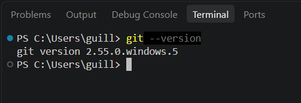

# Halloween Git Rescue: Horror at the Server Room

**Autor:** Guillem Barjuan
**Cicle:** CFGS Desenvolupament d'Aplicacions Multiplataforma (1r curs)

## Presentació del cas

És la nit de la vespra de Tots Sants, a les 23:45 h. Un antic desenvolupament maleït s'ha despertat a l'historial del projecte i un programador desaparegut injecta codi maliciós des d'una línia temporal paral·lela.

En aquest cas actuo com a enginyer de *Forensic Software*. La missió consisteix a:

1. Reconstruir des de zero el repositori local infectat.
2. Aïllar les visions del futur en branques independents (`feature-nightmare` i `feature-sanctuary`).
3. Afrontar el ritual de fusió i resoldre manualment el conflicte de codi.
4. Viatjar en el temps per eliminar el commit infectat i restaurar l'últim estat segur.
5. Publicar el repositori net a GitHub per a l'auditoria final.

## Entorn de treball

| Element | Valor |
|---|---|
| Sistema operatiu | Windows 10 |
| Terminal | PowerShell (terminal integrat de Visual Studio Code) |
| Editor | Visual Studio Code |
| Control de versions | Git (versió indicada a la captura de `git --version`) |
| Repositori remot | GitHub |



## Taula de continguts

- [Bloc 1: Invocació del Repositori i Línia Base](bloc1.md)
- [Bloc 2: Les Branques del Més Enllà i Resolució del Conflicte](bloc2.md)
- [Bloc 3: Viatge Temporal, Exorcisme del Codi i Publicació Remota](bloc3.md)

## Estructura del repositori

```
server-room-horror/
├── main.js        # Codi principal del sistema del servidor
├── README.md      # Aquest document
├── bloc1.md       # Documentació del Bloc 1
├── bloc2.md       # Documentació del Bloc 2
├── bloc3.md       # Documentació del Bloc 3
└── captures/      # Captures de pantalla de la terminal
```
