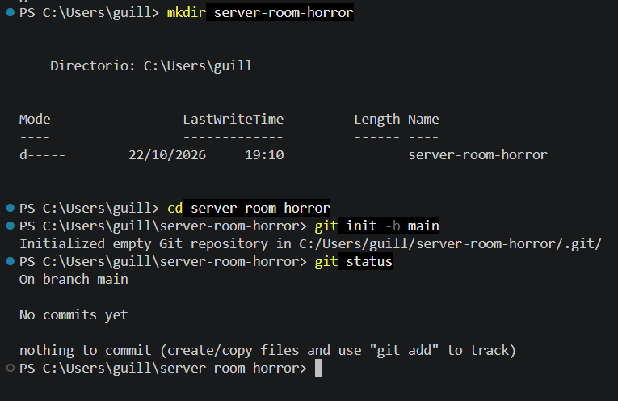
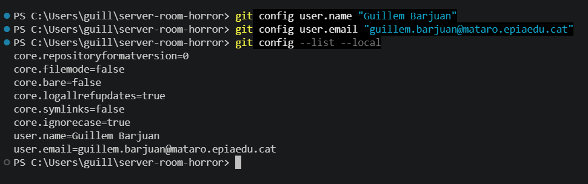
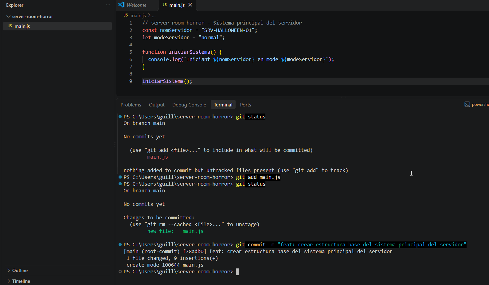
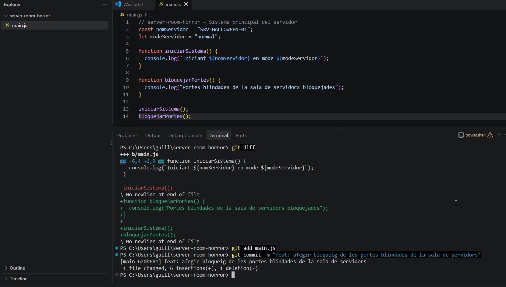
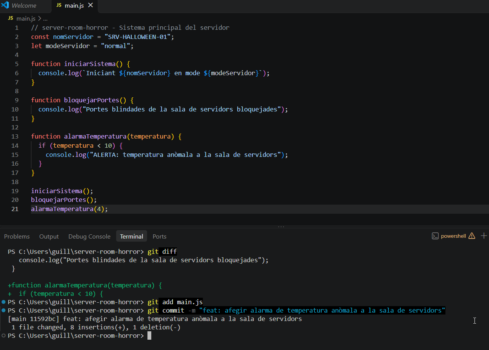
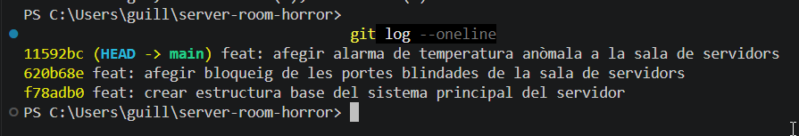

# Bloc 1: Invocació del Repositori i Línia Base

[← Tornar a l'índex](README.md)

## Acció 3.1 – Creació del repositori local

Es crea el directori `server-room-horror`, que serà l'escena del cas, i s'hi inicialitza un repositori Git buit. L'opció `-b main` estableix `main` com a branca principal des del primer moment. `git status` confirma que el repositori existeix i que encara no té cap commit.

```bash
mkdir server-room-horror
cd server-room-horror
git init -b main
git status
```



## Acció 3.2 – Identificació de l'enginyer forense

Es configura el nom i el correu a nivell de repositori (sense `--global`), de manera que tots els commits d'aquesta investigació quedin signats amb la meva identitat professional i se'n pugui auditar l'autoria. L'última ordre mostra la configuració local per verificar-la.

```bash
git config user.name "Guillem Barjuan"
git config user.email "guillem.barjuan@mataro.epiaedu.cat"
git config --list --local
```



## Acció 3.3 – Línia base del sistema (1r commit)

Es crea `main.js` amb l'estructura base del sistema del servidor: el nom del servidor, la variable `modeServidor` i la funció d'arrencada. Abans d'afegir-lo, `git status` el mostra com a fitxer no seguit. Després es passa a la zona d'intercanvi i es registra el primer commit.

```bash
git status
git add main.js
git status
git commit -m "feat: crear estructura base del sistema principal del servidor"
```



## Acció 3.4 – Sistema de seguretat de l'edifici (2n i 3r commit)

S'apliquen dues modificacions successives, cadascuna amb el seu commit, perquè l'historial reflecteixi cada mesura de seguretat per separat:

1. Bloqueig de les portes blindades de la sala de servidors.
2. Alarma de temperatura anòmala.

```bash
git diff
git add main.js
git commit -m "feat: afegir bloqueig de les portes blindades de la sala de servidors"
```



```bash
git diff
git add main.js
git commit -m "feat: afegir alarma de temperatura anòmala a la sala de servidors"
```



## Acció 3.5 – Verificació de la línia temporal inicial

Es mostra l'historial simplificat en una sola línia per commit. Apareixen els tres commits en ordre, amb `HEAD -> main` apuntant a l'últim, cosa que confirma que la línia temporal inicial és estable.

```bash
git log --oneline
```



[← Tornar a l'índex](README.md) · [Bloc 2 →](bloc2.md)
