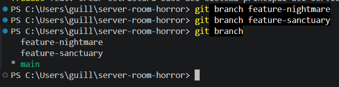
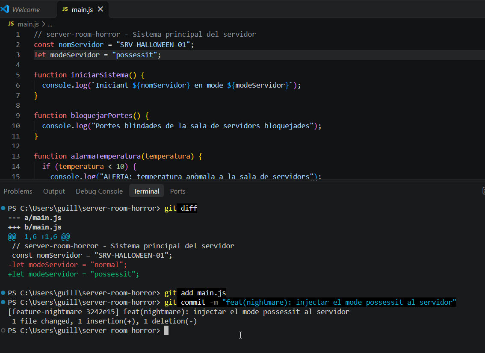
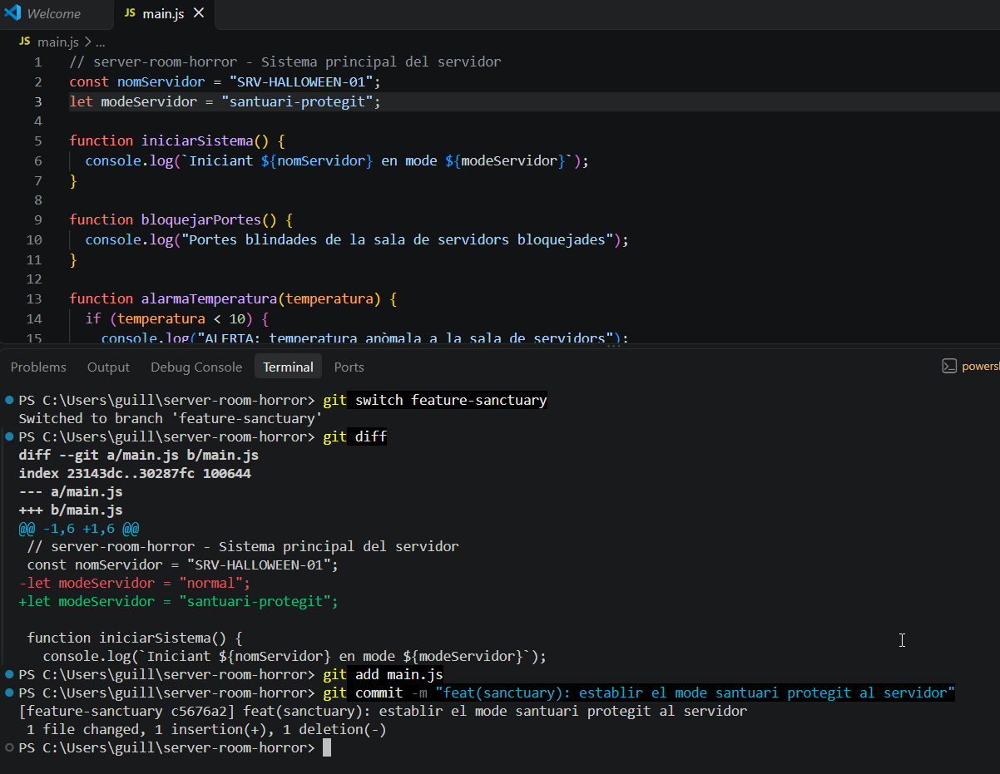
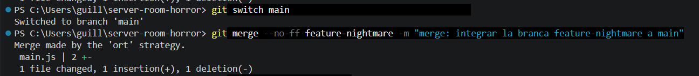
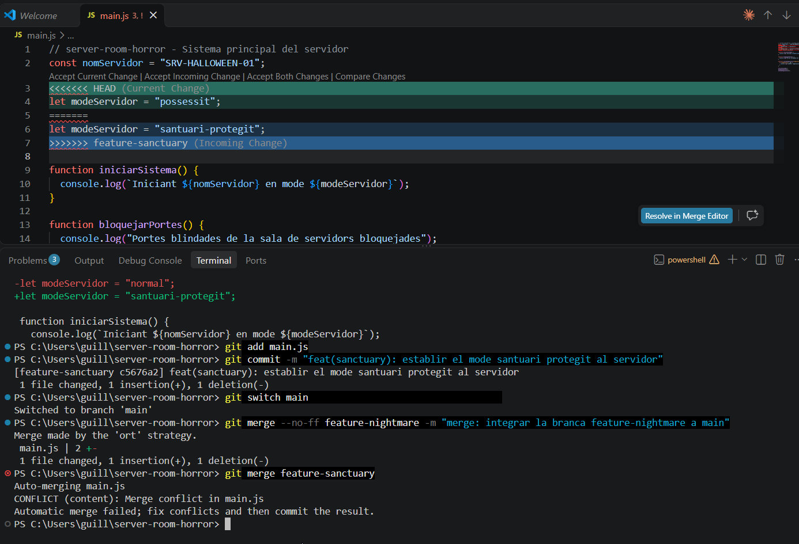
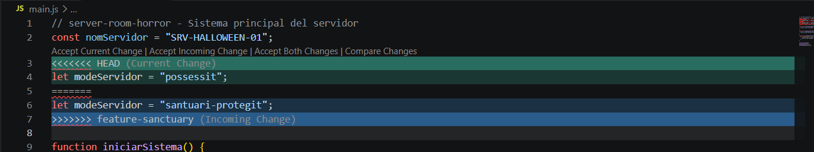
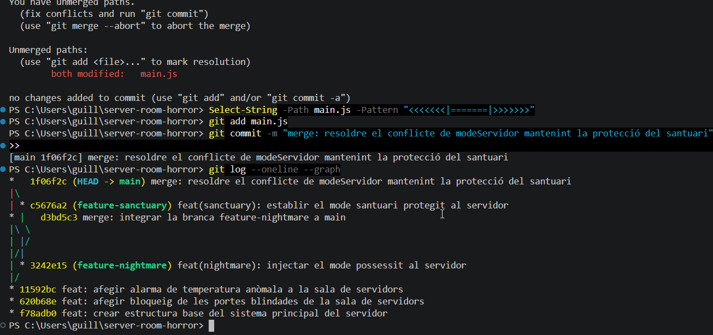

# Bloc 2: Les Branques del Més Enllà i Resolució del Conflicte

[← Tornar a l'índex](README.md)

## Acció 3.6 – Creació de les dues línies temporals

Es creen les branques `feature-nightmare` (dimensió fosca) i `feature-sanctuary` (línia de protecció).

```bash
git branch feature-nightmare
git branch feature-sanctuary
git branch
```



### Justificació de la topologia

Les dues branques neixen **del mateix punt**: l'últim commit estable de `main` (el de l'alarma de temperatura). He escollit aquesta topologia per tres motius:

- **Base comuna i segura.** Totes dues visions parteixen del sistema de seguretat complet i verificat, igual que en un projecte real on les funcionalitats es desenvolupen a partir de la versió estable de producció.
- **Aïllament real.** Si `feature-sanctuary` hagués nascut de `feature-nightmare`, hauria heretat el codi maleït i la integració hauria estat un simple *fast-forward*, sense cap conflicte que demostrés la col·lisió entre les dues visions.
- **Traçabilitat.** Com que les dues branques modifiquen la mateixa línia a partir de la mateixa versió, el conflicte és clar i es pot auditar exactament què va proposar cada línia temporal.

## Acció 3.7 – La visió fosca

Des de `feature-nightmare` es modifica la línia `modeServidor` per injectar la lògica de la visió fosca (`"possessit"`) i es registra el canvi.

```bash
git switch feature-nightmare
git diff
git add main.js
git commit -m "feat(nightmare): injectar el mode possessit al servidor"
```



## Acció 3.8 – La protecció del santuari

Des de `feature-sanctuary` es modifica **exactament la mateixa línia** amb la lògica de protecció (`"santuari-protegit"`). Aquesta branca no veu el canvi de `feature-nightmare` perquè totes dues són independents.

```bash
git switch feature-sanctuary
git diff
git add main.js
git commit -m "feat(sanctuary): establir el mode santuari protegit al servidor"
```



## Acció 3.9 – El ritual de fusió

Es torna a `main`, la branca receptora. Primer s'integra `feature-nightmare` amb `--no-ff`, que obliga Git a crear un commit de fusió encara que es pogués fer *fast-forward*. Així la branca queda visible a l'arbre de l'historial. A continuació s'intenta integrar `feature-sanctuary`.

```bash
git switch main
git merge --no-ff feature-nightmare -m "merge: integrar la branca feature-nightmare a main"
git merge feature-sanctuary
```



La segona integració s'atura amb un `CONFLICT (content)` a `main.js`, perquè totes dues branques han modificat la mateixa línia.



## Acció 3.10 – Resolució del conflicte

Git marca la zona en conflicte dins de `main.js`:

```
<<<<<<< HEAD
let modeServidor = "possessit"; // la visió fosca pren el control
=======
let modeServidor = "santuari-protegit"; // protecció activa contra intrusions
>>>>>>> feature-sanctuary
```



Per salvar el servidor es conserva **només la versió del santuari** i s'eliminen les tres línies de marques (`<<<<<<<`, `=======`, `>>>>>>>`). Abans de fer el commit es comprova que no en queda cap al fitxer (l'ordre no ha de retornar res). Després es marca el fitxer com a resolt i es finalitza la integració amb el commit de fusió.

```bash
git status
Select-String -Path main.js -Pattern "<<<<<<<|=======|>>>>>>>"
git add main.js
git commit -m "merge: resoldre el conflicte de modeServidor mantenint la protecció del santuari"
git log --oneline --graph
```



[← Bloc 1](bloc1.md) · [Tornar a l'índex](README.md) · [Bloc 3 →](bloc3.md)
