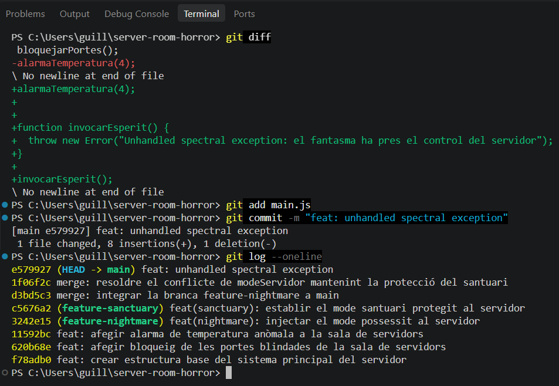
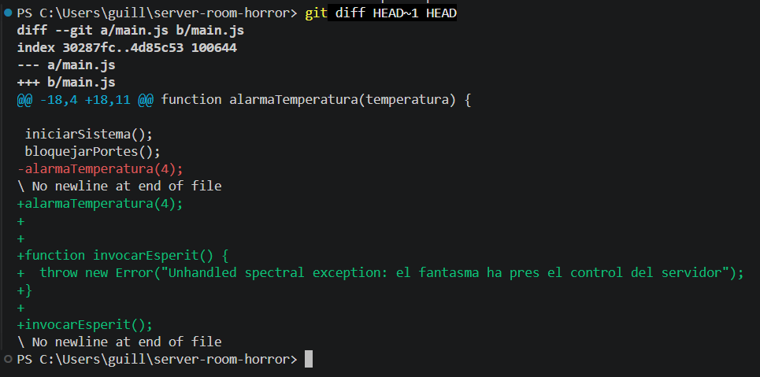
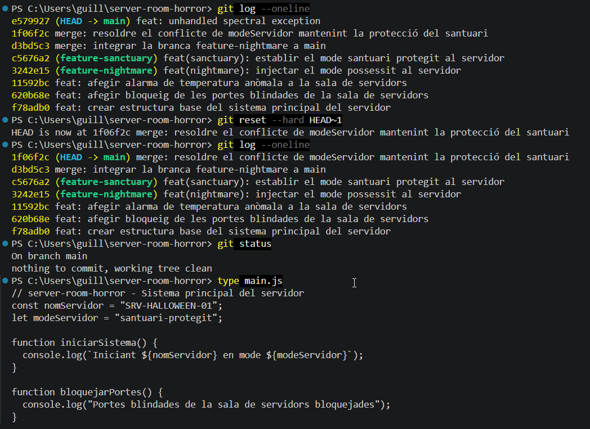
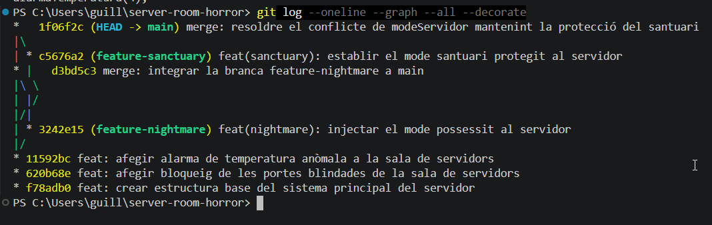
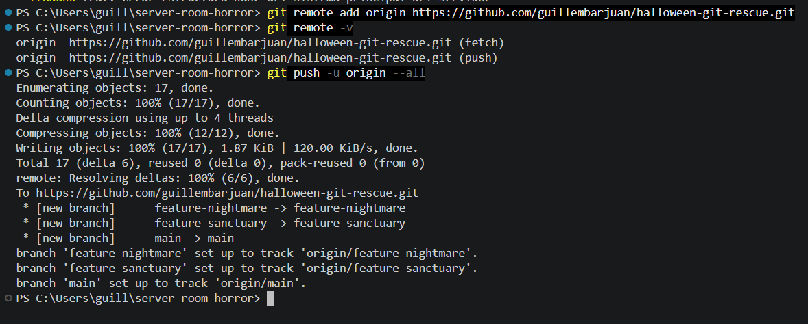
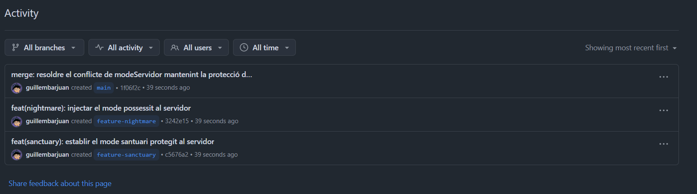

# Bloc 3: Viatge Temporal, Exorcisme del Codi i Publicació Remota

[← Tornar a l'índex](README.md)

## Acció 3.11 – El commit infectat

L'esperit aconsegueix injectar a `main.js` una funció que llança una excepció no controlada i la invoca en arrencar, la qual cosa fa caure el sistema. Aquest estat defectuós queda registrat a l'historial.

```bash
git diff
git add main.js
git commit -m "feat: unhandled spectral exception"
git log --oneline
```



## Acció 3.12 – Anàlisi forense del codi infectat

Es compara el commit actual (`HEAD`) amb el darrer punt segur (`HEAD~1`, el commit de fusió). Les línies marcades amb `+` corresponen exactament al codi maliciós introduït.

```bash
git diff HEAD~1 HEAD
```



## Acció 3.13 – Exorcisme: reversió temporal

Amb `git reset --hard HEAD~1` el punter de `main` torna al commit de fusió segur. L'opció `--hard` elimina el commit infectat de l'historial i també descarta el codi maliciós del directori de treball i de la zona d'intercanvi. Abans i després es consulta l'historial, i al final es verifica que l'estat és net i que `main.js` ja no conté la funció maleïda.

```bash
git log --oneline
git reset --hard HEAD~1
git log --oneline
git status
type main.js
```



## Acció 3.14 – Topologia final del repositori

Es visualitza l'arbre complet de l'historial des de la terminal: els tres commits de la línia base, les dues branques, els dos commits de fusió i la línia temporal ja purificada, sense el commit infectat.

```bash
git log --oneline --graph --all --decorate
```



## Acció 3.15 – Publicació a GitHub

Es crea a GitHub el repositori públic `halloween-git-rescue` (buit, sense README). Es vincula com a remot `origin` i es pugen **totes les branques** amb `--all`, de manera que l'auditoria inclogui `main`, `feature-nightmare` i `feature-sanctuary` amb tot el seu historial.

```bash
git remote add origin https://github.com/EL-TEU-USUARI/halloween-git-rescue.git
git remote -v
git push -u origin --all
```





Enllaç al repositori: https://github.com/guillembarjuan/halloween-git-rescue

[← Bloc 2](bloc2.md) · [Tornar a l'índex](README.md)
